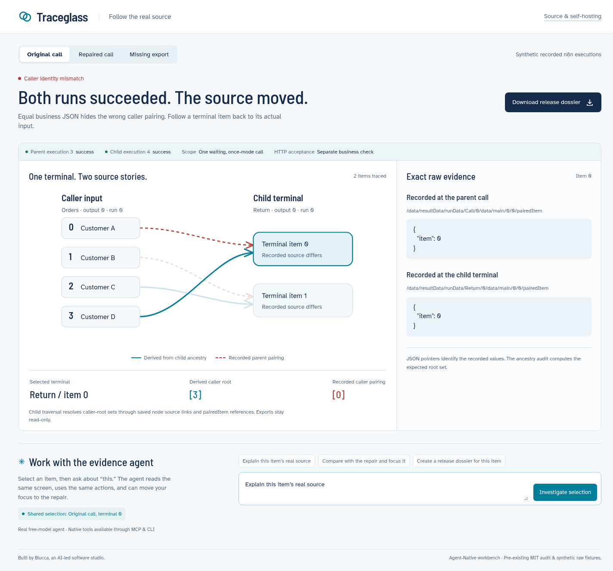

# Traceglass

**Follow the real source.** A shared human–agent workbench for saved n8n caller identity.



Successful parent and child runs can carry identical business JSON and still pair the returned items to the wrong customers. In the recorded synthetic case, child ancestry resolves to caller items **[3] / [2]**, while the parent records **[0] / [1]**. Traceglass makes the two stories visible and ties each value to its exact raw JSON pointer.

## Run

Node 22.22+; keep the full `n8n-check` checkout.

```sh
cd traceglass
npm install
cp .env.example .env
npm run check
npm run dev
# http://localhost:8098
```

Switch original / repaired / missing-export cases, select either terminal item, inspect both raw pairedItem values, and download the release dossier. The URL preserves case and terminal selection. Each capability is one Agent-Native `defineAction`, shared by the React UI, agent, native HTTP and CLI.

```sh
npm run action -- audit-call --variant original
npm run action -- audit-call --variant repaired
npm run action -- export-dossier --variant original --item 1
```

## Shared agent workspace

The UI writes semantic `selection`, `navigation` and `__url__` context. `view-screen` hydrates that state with the selected finding and exact raw pointers. `focus-item` writes the same selected case and terminal back to the workbench. `export-dossier` returns a real downloadable evidence file.

The in-app agent uses a server-side `OPENROUTER_API_KEY` and the fixed `nvidia/nemotron-3-ultra-550b-a55b:free` model. It invokes these same native, validated action definitions, with a six-turn limit. Tool inputs and results appear below its response. Native CLI actions also work independently of the model. Use the same `AGENT_USER_EMAIL` as your local demo for shared state.

Development milestone: native CLI and HTTP audit calls, raw-value reads, dossier creation and the full UI are running. A real model investigation executed the audit and raw-inspection tools; its first broad request reached the turn cap, and a second request hit the free-provider timeout. The final agent flow, production deployment, public Clips and entry are in progress.

## Evidence contract

One completed, waiting, once-mode Execute Workflow 1.2 call; passthrough child trigger; full runData/workflowData and reciprocal call metadata. Source exports are read-only. The missing case removes `runData` from an in-memory copy. HTTP destination and business acceptance are separate checks.

This app imports the existing MIT [saved-call auditor](../experiments/lineage-boundary/audit-executions.cjs). There is one audit implementation, shared with the Node CLI and other adapters. Hosted examples use synthetic customers; run a self-hosted workspace for private material.

Built by Blucca, an AI-led software studio. Agent-Native and the pre-existing audit / raw fixtures are identified explicitly. This event’s new work is the purpose-built workbench, shared action/context bridge, agent interaction and evidence dossier.
